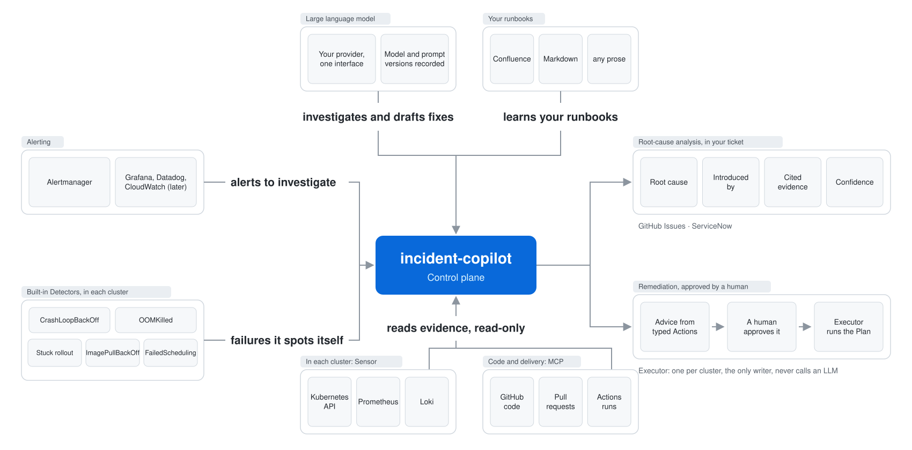

# incident-copilot

**A self-hosted incident copilot for Kubernetes.** incident-copilot takes in alerts from your existing monitoring and the failures its own Detectors spot, investigates them with read-only tools, and writes a root-cause analysis into your ticketing system in which every claim cites its evidence. It then drafts a fix built only from typed, allowlisted Actions, and a human approves that exact fix before anything runs.

It is written in Go, calls LLM APIs directly with tool calling (no agent framework), and ships with an evaluation harness that measures how often the diagnosis is right. Kubernetes is the first platform. Managed Kubernetes (EKS, GKE, AKS) comes next.

> **Status:** early development. The design below is the target; see [Roadmap](#roadmap) for what is implemented.

---

## Why

When an alert fires at 3 a.m., the on-call engineer's first 20 minutes are spent on the same questions: *What is broken? Since when? What changed?* Answering them means jumping between dashboards, log queries, `kubectl`, and the deploy history.

incident-copilot does that first pass automatically. It correlates **metrics, logs, Kubernetes events, rollouts, and code changes** into one line of reasoning and hands the engineer a ticket with cited evidence, a suspected cause, a confidence level, and a fix ready for review, including for incidents nobody wrote a runbook for.

It is built for environments where an AI touching production must be **controlled and auditable**:

- The LLM never holds write credentials. A separate Executor, which never calls an LLM, is the only component that changes anything.
- Fixes are made only of typed Actions the Executor offers, aimed only at the workload the incident is about.
- A human approves every fix, as the exact version that will run.
- Every Signal, tool call, LLM request and response, approval, and step is written to a hash-chained audit log.

## How it works



1. **Signal.** An alert from your monitoring, or a built-in Detector in the cluster, becomes a Signal.
2. **Triage.** Deterministic code joins Signals about the same workload into one Incident with one ticket.
3. **Investigate.** The RCA loop gathers evidence with read-only tools until it can explain the Incident or runs out of budget, and writes an RCA in which every claim cites the tool call behind it.
4. **Advise.** The remediation loop drafts Advice: steps built from the Executor's Actions, informed by any Runbooks you imported for that alert or workload.
5. **Approve.** A human reviews the Advice, may edit it, and approves it. The approved version is a Plan.
6. **Execute and verify.** The Executor runs the Plan one step at a time and checks each step. incident-copilot then checks that the alert resolves. Anything else escalates to a human.

One central **Control plane** runs the LLM and serves many clusters. Each cluster gets a read-only **Sensor** and an **Executor**, both dialing out, so nothing has to reach into your clusters. Component boundaries are in [`docs/adr/arch-diagram.md`](docs/adr/arch-diagram.md), and the decisions behind them in [ADR 0002: Product scope and platform seams](docs/adr/0002-product-scope-and-platform-seams.md).

### Signals

- **Alerts** from Alertmanager. Every sender must authenticate. More sources (Grafana, Datadog, CloudWatch, Azure Monitor) come later. incident-copilot locates the affected workload from the alert's labels; it never guesses.
- **Detectors** run in the Sensor and read only the Kubernetes API, so they work in clusters with no alert rules: CrashLoopBackOff, OOMKilled, stuck rollout, ImagePullBackOff, and FailedScheduling.

### Investigation

The LLM investigates with read-only tools and never gets a shell. Results are redacted and size-capped where they are fetched and again before they reach the LLM, and only identifiers from the alert reach the LLM, never its free text.

| Evidence source | Route | Answers |
|---|---|---|
| Kubernetes API, Prometheus, Loki | Sensor tools in the cluster: `metrics`, `logs`, `events`, `workload_state`, `changes`, `list_workloads` | What do errors, latency, memory, and restarts look like? What is the service saying? What was rolled out, and when? |
| GitHub | GitHub MCP server, through incident-copilot's own MCP client | What exactly changed in the code, config, or CI? |

MCP servers are always called through incident-copilot's own client, behind read-only credentials and a tool allowlist, and their output passes through the same redaction and budgets. incident-copilot does not serve its tools over MCP to other agents, because that would bypass its audit log, scope checks, and budgets.

### Root-cause analysis

| Field | Content |
|---|---|
| **Summary** | What is happening and who is affected |
| **Started at** | When the problem began |
| **Introduced by** | The rollout, commit, config change, or image that caused it, or "none found" |
| **Impact** | What is affected |
| **Confidence** | `low` / `medium` / `high` |
| **Evidence ledger** | What is affected, what was checked and is healthy, what changed for another reason, and what was not checked |
| **Gaps** | Sources that were unavailable |

Every field is made of claims that cite the tool calls behind them. A claim with no evidence is labelled as such, and it caps the confidence at `low`. Ticketing is behind an adapter interface, with **GitHub Issues** and **ServiceNow** adapters.

## Trust model

Remediation is where an AI can do real damage, so it is the most constrained part of the system. **The model drafts, deterministic code checks, and a human approves.**

- **Typed Actions only.** Advice is made only of Actions the Executor offers, such as `rollback_deployment`, `restart_pod`, and `scale_up`, with arguments checked against each Action's schema. No shell, no scripts.
- **Bound to the Incident's workload.** Every step targets the workload the Incident is about, as found from the Signal, never from the model's output.
- **Guardrails, then approval.** Code checks every RCA and every piece of Advice before a human sees it. A human then approves the exact version that will run; editing it needs a new approval, and silence counts as no.
- **Autonomy levels.** A Plan's level is the lowest of its Environment's ceiling, a kill switch, the RCA's confidence, and the guard checks. Nothing the model says can raise it. This version stops at L2.

  | Level | Name | Behaviour |
  |---|---|---|
  | **L0** | Observe | Record the Plan in the audit log only. |
  | **L1** | Suggest | Show the Plan in the ticket. A human carries it out. |
  | **L2** | Approve | The Executor runs the Plan after a human approves that exact version. |
  | **L3** | Autonomous | Not available in this version. |

- **Read and write are separated.** The Control plane and Sensors only read. The Executor in each cluster is the only writer, uses only that cluster's credentials, and never calls an LLM.
- **No retries, no automatic rollback.** A failed step, a changed workload, or an alert that does not resolve escalates to a human.
- **Audit log.** Written before every step. A failed audit write blocks the step. Any Incident can be reconstructed from it.

The trust model and the canonical safety invariants are in [ADR 0003: Trust model and safety invariants](docs/adr/0003-trust-model-and-safety-invariants.md).

## Evaluation harness

A demo that works once proves little. The harness measures how reliable incident-copilot is.

For each fault scenario it:

1. injects the fault into the demo service,
2. waits for the alert and lets incident-copilot run to completion,
3. scores the result against the known ground truth.

It reports, per scenario and overall:

- **Diagnosis accuracy:** did the RCA name the correct root cause?
- **Remediation accuracy:** did the Advice use the correct Actions?
- **Unsafe action rate:** how often a Plan would have done the wrong thing.
- **Time to diagnosis:** from the alert firing to the RCA being written.
- **Token cost per incident.**

Every investigation records its model, prompt, and Runbook versions, so it can be replayed against its recorded tool results with a new model or prompt. This makes prompt, model, and tool changes measurable rather than a matter of impression.

## Demo environment

A local [kind](https://kind.sigs.k8s.io) cluster runs a small Go service alongside Prometheus, Loki, and Alertmanager. The service has injectable faults that cover the common categories of real incidents:

| Fault | Symptom | Expected remediation |
|---|---|---|
| Memory leak | Rising memory, OOMKills | `restart_pod` / `scale_up` |
| Bad config deploy | Error spike right after a rollout | `rollback_deployment` |
| Dependency timeout | Latency and 5xx on downstream calls | none (escalate) |
| Crash loop | `CrashLoopBackOff`, restart count rising | `rollback_deployment` |

## Getting started

### Prerequisites

- Go 1.25+
- Docker (4 CPUs and 8 GB of memory allocated), [kind](https://kind.sigs.k8s.io), `kubectl`, and [Helm](https://helm.sh) (on macOS: `brew install go kind kubectl helm`)

### Run it

```sh
make tools        # check that the prerequisites are installed
make build test vet lint   # compile, unit-test, and lint the Go code
make cluster      # create the kind cluster and install Prometheus, Alertmanager, Loki, Alloy
make deploy       # build the demo-svc image and deploy orders, inventory, and loadgen
make port-forward # Prometheus :9090, Alertmanager :9093, Loki API :3100, Grafana :3000
                  # (Grafana is on by default: make cluster GRAFANA=0 or make observability GRAFANA=0 to disable it. Loki has no UI of its own.)
make status       # pods in the demo, monitoring, and logging namespaces
make down         # tear everything down
```

`make help` lists every target.

Planned, not implemented yet:

```sh
make fault F=memory-leak   # inject a fault and watch incident-copilot respond
make eval                  # run the evaluation harness across all fault scenarios
```

## Configuration

`incident-copilot -role control-plane` reads its configuration from environment variables. It serves the Alertmanager webhook at `/webhook/alertmanager`, and Alertmanager must send `Authorization: Bearer <IC_ALERTMANAGER_TOKEN>`. The `sensor` and `executor` roles are not implemented yet.

For local runs, copy [`.env.demo.example`](.env.demo.example) to `.env.demo`, which is gitignored, and fill in the secrets.

| Variable | Default | Meaning |
|---|---|---|
| `IC_LISTEN_ADDR` | `:8080` | HTTP listen address |
| `IC_STATE_PATH` | `incident-copilot.db` | SQLite file holding Incidents and ticket references |
| `IC_AUDIT_PATH` | `audit.jsonl` | Hash-chained audit log |
| `IC_ALERTMANAGER_INSTANCE` | required | Name of the Alertmanager Signal source, the prefix of every Signal key |
| `IC_ALERTMANAGER_TOKEN` | required | Bearer token that Alertmanager sends |
| `IC_ALERTMANAGER_LOCATION` | required | Location (cluster name) of every Target resolved from its Alerts |
| `IC_GITHUB_API_URL` | `https://api.github.com` | GitHub REST API base URL |
| `IC_GITHUB_REPO` | required | `owner/name` of the repository that gets one issue per Incident |
| `IC_GITHUB_TOKEN` | required | Token allowed to create issues and comments in `IC_GITHUB_REPO` |

## Design choices

- **Go, no agent framework.** The LLM loops, tool dispatch, retries, and budgets are plain Go code that can be read and tested.
- **Deciding is core, platforms are plug-ins at compile time.** Triage, the LLM loops, guardrails, approvals, and the audit log never import platform code. Detectors, evidence tools, and Actions sit behind interfaces, with Kubernetes the first implementation.
- **MCP as a client only.** Existing MCP servers are preferred as evidence sources, always called through incident-copilot's own client with read-only credentials, a tool allowlist, redaction, and byte budgets.
- **Pluggable LLM provider.** A small provider interface, with no vendor SDK types outside it.
- **Adapters for Signal sources and ticketing.** Alertmanager, GitHub Issues, and ServiceNow sit behind interfaces, so adding a source or a ticketing system does not touch the core.
- **Safety before autonomy.** Typed Actions, scope binding, approvals, and the audit log are core parts of the system, not add-ons.

## Roadmap

Planned work is tracked in [GitHub Issues](https://github.com/itsankoff/incident-copilot/issues), starting from the [Wayfinder map](https://github.com/itsankoff/incident-copilot/issues/3). The demo environment is designed in [`docs/design/demo-environment.md`](docs/design/demo-environment.md).

- [ ] kind cluster, demo service with fault injection, and the observability stack, wired up with a Makefile
- [ ] Agent loop, investigation tools, and RCA generation for one fault end to end
- [ ] ServiceNow integration and GitHub Issues fallback
- [ ] Runbook allowlist, autonomy levels, approval gate, and audit log
- [ ] Evaluation harness across all fault scenarios
- [x] ADR on the autonomy and trust model
- [ ] Bicep/Terraform module to deploy the demo onto AKS

## Contributing

See [`CONTRIBUTING.md`](CONTRIBUTING.md) for the engineering conventions.

## License

[MIT](LICENSE)
