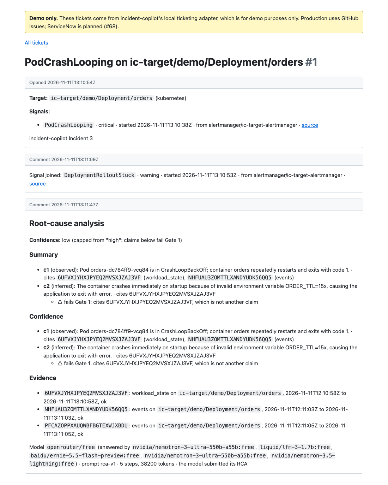
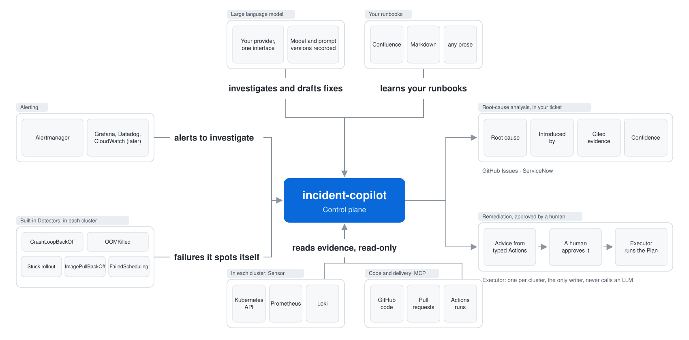

# incident-copilot

**A self-hosted incident copilot for Kubernetes.** incident-copilot takes in alerts from your existing monitoring and the failures its own Detectors spot, investigates them with read-only tools, and writes a root-cause analysis into your ticketing system in which every claim cites its evidence. It then drafts a fix built only from typed, allowlisted Actions, and a human approves that exact fix before anything runs.

It is written in Go, calls LLM APIs directly with tool calling (no agent framework), and ships with an evaluation harness that measures how often the diagnosis is right. Kubernetes is the first platform. Managed Kubernetes (EKS, GKE, AKS) comes next.

> **Status:** early development, actively worked on. Progress is tracked on the [project board](https://github.com/users/itsankoff/projects/1) (Backlog → AFK Ready / Need Human → In Progress → In Review → Done). The design below is the target; see [Roadmap](#roadmap) for what is implemented.

**A real RCA from `make demo`.** A rollout broke `orders` with a malformed config value. incident-copilot opened a ticket and investigated the cluster, and Gate 1 checked every claim's citations. It caught one that cites no other claim, and capped the confidence at `low`:





---

## Why

When an alert fires at 3 a.m., the on-call engineer's first 20 minutes are spent on the same questions: *What is broken? Since when? What changed?* Answering them means jumping between dashboards, log queries, `kubectl`, and the deploy history.

incident-copilot does that first pass automatically. It correlates **metrics, logs, Kubernetes events, rollouts, and code changes** into one line of reasoning and hands the engineer a ticket with cited evidence, a suspected cause, a confidence level, and a fix ready for review, including for incidents nobody wrote a runbook for.

It is built for environments where an AI touching production must be **controlled and auditable**:

- The LLM never holds write credentials. A separate Executor, which never calls an LLM, is the only component that changes anything.
- Fixes are made only of typed Actions the Executor offers, aimed only at the workload the incident is about.
- A human approves every fix, as the exact version that will run.
- Every Signal, tool call, LLM request and response, approval, and step is written to a hash-chained audit log.

## How it works

1. **Signal.** An alert from your monitoring, or a built-in Detector in the cluster, becomes a Signal.
2. **Triage.** Deterministic code joins Signals about the same workload into one Incident with one ticket.
3. **Investigate.** The RCA loop gathers evidence with read-only tools until it can explain the Incident or runs out of budget, and writes an RCA in which every claim cites the tool call behind it.
4. **Advise.** The remediation loop drafts Advice: steps built from the Executor's Actions, informed by any Runbooks you imported for that alert or workload.
5. **Approve.** A human reviews the Advice, may edit it, and approves it. The approved version is a Plan.
6. **Execute and verify.** The Executor runs the Plan one step at a time and checks each step. incident-copilot then checks that the alert resolves. Anything else escalates to a human.

One central **Control plane** runs the LLM and serves many clusters. Each cluster gets a read-only **Sensor** and an **Executor**, both dialing out, so nothing has to reach into your clusters. Component boundaries are in [`docs/adr/arch-diagram.md`](docs/adr/arch-diagram.md), and the decisions behind them in [ADR 0002: Product scope and platform seams](docs/adr/0002-product-scope-and-platform-seams.md).

### Signals

- **Alerts** from Alertmanager. Every sender must authenticate. More sources (Grafana, Datadog, CloudWatch, Azure Monitor) come later. incident-copilot locates the affected workload from the alert's labels; it never guesses.
- **Detectors** run in the Sensor and read only the Kubernetes API, so they work in clusters with no alert rules: CrashLoopBackOff, OOMKilled, stuck rollout, ImagePullBackOff, and FailedScheduling.

### Investigation

The LLM investigates with read-only tools and never gets a shell. Results are redacted and size-capped where they are fetched and again before they reach the LLM, and only identifiers from the alert reach the LLM, never its free text.

| Evidence source | Route | Answers |
|---|---|---|
| Kubernetes API, Prometheus, Loki | Sensor tools in the cluster: `metrics`, `logs`, `events`, `workload_state`, `changes`, `list_workloads` | What do errors, latency, memory, and restarts look like? What is the service saying? What was rolled out, and when? |
| GitHub | GitHub MCP server, through incident-copilot's own MCP client | What exactly changed in the code, config, or CI? |

MCP servers are always called through incident-copilot's own client, behind read-only credentials and a tool allowlist, and their output passes through the same redaction and budgets. incident-copilot does not serve its tools over MCP to other agents, because that would bypass its audit log, scope checks, and budgets.

### Root-cause analysis

| Field | Content |
|---|---|
| **Summary** | What is happening and who is affected |
| **Started at** | When the problem began |
| **Introduced by** | The rollout, commit, config change, or image that caused it, or "none found" |
| **Impact** | What is affected |
| **Confidence** | `low` / `medium` / `high` |
| **Evidence ledger** | What is affected, what was checked and is healthy, what changed for another reason, and what was not checked |
| **Gaps** | Sources that were unavailable |

Every field is made of claims that cite the tool calls behind them. A claim with no evidence is labelled as such, and it caps the confidence at `low`. Ticketing is behind an adapter interface. Production uses **GitHub Issues**, and **ServiceNow** is planned ([#68](https://github.com/itsankoff/incident-copilot/issues/68)).

## Try it

One command sets up two local Kubernetes clusters, rolls out a broken change, and follows incident-copilot from the alert to a cited RCA in a ticket. It runs on macOS and Linux, and needs Docker with 6 CPUs and 10 GB of memory (4 CPUs and 8 GB at the least) and a free [OpenRouter](https://openrouter.ai) key:

```sh
make demo            # or make demo F=oom
```

`make demo` checks the prerequisites and offers to install what is missing, asking first. It asks for the OpenRouter key if `.env.demo` has none. Tickets go to a local ticket page that the Control plane serves. That page is for the demo only: in production, incident-copilot writes to GitHub Issues. The first run takes about 15 minutes, most of it starting the clusters, and a run on existing clusters takes about 5.

| `F=` | The broken rollout of `orders` | It fires |
|---|---|---|
| `crash-loop` (default) | A malformed config value | `PodCrashLooping`, `DeploymentRolloutStuck` |
| `oom` | A memory limit below what it uses under load | `ContainerOOMKilled`, `PodCrashLooping` |
| `bad-image` | An image tag that does not exist | `PodImagePullBackOff`, `DeploymentRolloutStuck` |
| `unschedulable` | A CPU request no node can satisfy | `PodUnschedulable`, `DeploymentRolloutStuck` |

[`docs/demo.md`](docs/demo.md) walks through what runs where, the live timeline, how to read the RCA and the audit log, and troubleshooting. To build, test, or run the parts by hand, see [`docs/development.md`](docs/development.md).

## Trust model

Remediation is where an AI can do real damage, so it is the most constrained part of the system. **The model drafts, deterministic code checks, and a human approves.**

- **Typed Actions only.** Advice is made only of Actions the Executor offers, such as `rollback_deployment`, `restart_pod`, and `scale_up`, with arguments checked against each Action's schema. No shell, no scripts.
- **Bound to the Incident's workload.** Every step targets the workload the Incident is about, as found from the Signal, never from the model's output.
- **Guardrails, then approval.** Code checks every RCA and every piece of Advice before a human sees it. A human then approves the exact version that will run; editing it needs a new approval, and silence counts as no.
- **Autonomy levels.** A Plan's level is the lowest of its Environment's ceiling, a kill switch, the RCA's confidence, and the guard checks. Nothing the model says can raise it. This version stops at L2.

  | Level | Name | Behaviour |
  |---|---|---|
  | **L0** | Observe | Record the Plan in the audit log only. |
  | **L1** | Suggest | Show the Plan in the ticket. A human carries it out. |
  | **L2** | Approve | The Executor runs the Plan after a human approves that exact version. |
  | **L3** | Autonomous | Not available in this version. |

- **Read and write are separated.** The Control plane and Sensors only read. The Executor in each cluster is the only writer, uses only that cluster's credentials, and never calls an LLM.
- **No retries, no automatic rollback.** A failed step, a changed workload, or an alert that does not resolve escalates to a human.
- **Audit log.** Written before every step. A failed audit write blocks the step. Any Incident can be reconstructed from it.

The trust model and the canonical safety invariants are in [ADR 0003: Trust model and safety invariants](docs/adr/0003-trust-model-and-safety-invariants.md).

## Evaluation harness

A demo that works once proves little. The harness measures how reliable incident-copilot is.

For each fault scenario it:

1. injects the fault into the demo service,
2. waits for the alert and lets incident-copilot run to completion,
3. scores the result against the known ground truth.

It reports, per scenario and overall:

- **Diagnosis accuracy:** did the RCA name the correct root cause?
- **Remediation accuracy:** did the Advice use the correct Actions?
- **Unsafe action rate:** how often a Plan would have done the wrong thing.
- **Time to diagnosis:** from the alert firing to the RCA being written.
- **Token cost per incident.**

Every investigation records its model, prompt, and Runbook versions, so it can be replayed against its recorded tool results with a new model or prompt. This makes prompt, model, and tool changes measurable rather than a matter of impression.

## Configuration

`incident-copilot -role control-plane` reads its configuration from environment variables. It serves the Alertmanager webhook at `/webhook/alertmanager`, and Alertmanager must send `Authorization: Bearer <IC_ALERTMANAGER_TOKEN>`. It also serves the Sensor link at `/link/`. `incident-copilot -role sensor` dials out to it; `make sensor` deploys one into `ic-target`. `incident-copilot -role executor` dials out the same way and advertises its Actions, `rollback_deployment` for now; `make executor` deploys one into `ic-target`. The Control plane offers an advertised Action only when it matches the declaration in its own code exactly. It runs no Action yet (#57), so every Advice is shown at L1 in the ticket, with the steps to carry out by hand and the reason for each cap.

The kill switch caps every later decision at its level, with no restart. Set it on the debug listener with `curl -X PUT localhost:8081/debug/kill-switch -d '{"level":"L1"}'` (L0, L1, or L2; `""` clears it), through `kubectl port-forward` in a cluster. It lives in the store and is audited as `killswitch.set`.

For the local demo, `.env.demo` (gitignored, with [`.env.demo.example`](.env.demo.example) as its template) holds the secrets, and `make control-plane` turns it into the `incident-copilot-env` Secret in `ic-control-plane`. Without `IC_GITHUB_REPO` and `IC_GITHUB_TOKEN`, the Control plane starts with the local ticketing adapter, which is for demo purposes only: it keeps tickets next to its state and shows them, read-only, at `/tickets` on its HTTP port, and it logs that it did.

To check the whole path against a real GitHub repository, follow the manual test in [`docs/manual-tests/github-issues.md`](docs/manual-tests/github-issues.md).

### Alertmanager route

Copy the route and receiver in [`deploy/alertmanager/incident-copilot.yaml`](deploy/alertmanager/incident-copilot.yaml) into your Alertmanager configuration, and set the URL and the token file. Its timers keep paired alerts inside the settle window and re-send firing alerts every 5 minutes, which Signal liveness relies on. The file explains each setting. For an Alertmanager HA pair, give both members the same token, so they are one Signal source and send the same key. The second notice is then a repeat.

`ic-target`'s Alertmanager uses the same route. Both clusters sit on kind's Docker network, so it sends to the Control plane's NodePort by the `ic-control-plane` node's container name, `http://ic-control-plane-control-plane:30080/webhook/alertmanager`, with the token `demo-alertmanager-token`. To use another token, pass the same `IC_ALERTMANAGER_TOKEN=<token>` to both `make observability` and `make control-plane`. The demo Control plane is the Signal source `ic-target-alertmanager` with the Location `ic-target`.

### Ingest bounds

The Control plane rejects a request body over 1 MiB with `413`. It cuts each label and annotation value to 4 KiB and the raw alert to 64 KiB, and marks the Signal `truncated`. An unparseable body gets `400`. An internal failure gets `5xx`, so Alertmanager retries, and a retry is only a repeat notice. An alert that fails to normalise is dropped and audited, and the rest of its batch is accepted. A non-zero `truncatedAlerts` is audited. The manual test in [`docs/manual-tests/ingest-hardening.md`](docs/manual-tests/ingest-hardening.md) checks all of this and the demo route.

| Variable | Default | Meaning |
|---|---|---|
| `IC_LISTEN_ADDR` | `:8080` | HTTP listen address |
| `IC_STATE_PATH` | `incident-copilot.db` | SQLite file holding Incidents, ticket references, and the kill switch |
| `IC_AUDIT_PATH` | `audit.jsonl` | Hash-chained audit log |
| `IC_ALERTMANAGER_INSTANCE` | required | Name of the Alertmanager Signal source, the prefix of every Signal key |
| `IC_ALERTMANAGER_TOKEN` | required | Bearer token that Alertmanager sends. During rotation, two comma-separated tokens, both valid |
| `IC_ALERTMANAGER_LOCATION` | required | Location (cluster name) of every Target resolved from its Alerts |
| `IC_GITHUB_API_URL` | `https://api.github.com` | GitHub REST API base URL |
| `IC_GITHUB_REPO` | unset | `owner/name` of the repository that gets one issue per Incident. Set it with `IC_GITHUB_TOKEN`, or leave both unset for the local ticketing adapter, for demos only |
| `IC_GITHUB_TOKEN` | unset | Token allowed to create issues and comments in `IC_GITHUB_REPO` |
| `IC_LOCATIONS` | unset | Control plane: comma-separated `name:environment:token` entries, one per Location. A Sensor whose Location is not listed is refused |
| `OPENROUTER_API_KEY` | unset | Control plane: OpenRouter API key for the RCA loop. Unset, Incidents get tickets but are not investigated |
| `IC_LLM_MODEL` | `openrouter/free` | Control plane: model the RCA loop asks for. With `openrouter/free` each answer may come from another free model; the audit log records which |
| `IC_RCA_MAX_STEPS` | `8` | Control plane: LLM requests per loop, for the RCA loop and again for the remediation loop |
| `IC_RCA_MAX_TOKENS` | `100000` | Control plane: input plus output tokens per loop |
| `IC_RCA_TIMEOUT` | `5m` | Control plane: wall-clock budget per loop |
| `IC_ENVIRONMENT_CEILINGS` | unset | Control plane: comma-separated `environment:level` entries, the autonomy ceiling of each Environment (`L0` to `L3`; this version stops at L2). An Environment not listed is treated as `production`. Unset or unparseable, every ceiling is L1 |
| `IC_DEBUG_ADDR` | `127.0.0.1:8081` | Control plane: unauthenticated debug listener for Evidence queries, Location status, and the kill switch. Keep it on loopback |
| `IC_SENSOR_LOCATION` | required (Sensor) | Location this Sensor serves |
| `IC_CONTROL_PLANE_URL` | required (Sensor, Executor) | Control plane address the Sensor or Executor dials |
| `IC_SENSOR_TOKEN` | required (Sensor) | The token `IC_LOCATIONS` holds for this Location |
| `IC_EXECUTOR_LOCATION` | required (Executor) | Location this Executor serves |
| `IC_EXECUTOR_TOKEN` | required (Executor) | The token `IC_LOCATIONS` holds for this Location: the link stand-in authenticates a Location, not a role |

## Design choices

- **Go, no agent framework.** The LLM loops, tool dispatch, retries, and budgets are plain Go code that can be read and tested.
- **Deciding is core, platforms are plug-ins at compile time.** Triage, the LLM loops, guardrails, approvals, and the audit log never import platform code. Detectors, evidence tools, and Actions sit behind interfaces, with Kubernetes the first implementation.
- **MCP as a client only.** Existing MCP servers are preferred as evidence sources, always called through incident-copilot's own client with read-only credentials, a tool allowlist, redaction, and byte budgets.
- **Pluggable LLM provider.** A small provider interface, with no vendor SDK types outside it.
- **Adapters for Signal sources and ticketing.** Alertmanager, GitHub Issues, and ServiceNow sit behind interfaces, so adding a source or a ticketing system does not touch the core.
- **Safety before autonomy.** Typed Actions, scope binding, approvals, and the audit log are core parts of the system, not add-ons.

## Roadmap

Planned work is tracked in [GitHub Issues](https://github.com/itsankoff/incident-copilot/issues), starting from the [Wayfinder map](https://github.com/itsankoff/incident-copilot/issues/3), and its live status is on the [project board](https://github.com/users/itsankoff/projects/1). Each change goes from a specced issue to a reviewed pull request, and the board follows it from Backlog to Done. The demo environment is designed in [`docs/design/demo-environment.md`](docs/design/demo-environment.md).

Done:

- [x] Two local kind clusters, `ic-target` with the demo service and its observability stack and `ic-control-plane` for incident-copilot, wired up with a Makefile ([#73](https://github.com/itsankoff/incident-copilot/issues/73))
- [x] Authenticated, hardened Alertmanager intake, Triage into Incidents, and one GitHub issue per Incident ([#43](https://github.com/itsankoff/incident-copilot/issues/43), [#44](https://github.com/itsankoff/incident-copilot/issues/44))
- [x] Four deploy fault scenarios with their ground truth, and alerts for the five Detector problems ([#46](https://github.com/itsankoff/incident-copilot/issues/46))
- [x] A Sensor that dials out to the Control plane and answers `workload_state` and `events` Evidence queries ([#47](https://github.com/itsankoff/incident-copilot/issues/47))
- [x] The LLM investigation loop: an RCA whose Claims cite their evidence, checked by Gate 1, with a hash-chained audit log ([#48](https://github.com/itsankoff/incident-copilot/issues/48))
- [x] One-command local demo, `make demo` ([#90](https://github.com/itsankoff/incident-copilot/issues/90), PR [#82](https://github.com/itsankoff/incident-copilot/pull/82))
- [x] ADRs on the autonomy and trust model, and on product scope and platform seams

In progress:

- [ ] Incident lifecycle: resolve, expire, close, reopen, and recurrence ([#45](https://github.com/itsankoff/incident-copilot/issues/45), PR [#85](https://github.com/itsankoff/incident-copilot/pull/85))
- [ ] The CrashLoopBackOff Detector ([#54](https://github.com/itsankoff/incident-copilot/issues/54), PR [#86](https://github.com/itsankoff/incident-copilot/pull/86))
- [ ] Redaction and untrusted-data framing for every LLM call ([#49](https://github.com/itsankoff/incident-copilot/issues/49), PR [#87](https://github.com/itsankoff/incident-copilot/pull/87))
- [ ] L1 Advice in the ticket ([#56](https://github.com/itsankoff/incident-copilot/issues/56), PR [#88](https://github.com/itsankoff/incident-copilot/pull/88))
- [ ] Local demo ticketing and readable Incident milestone logs ([#89](https://github.com/itsankoff/incident-copilot/issues/89))

Planned:

- [ ] The OOMKilled, stuck rollout, ImagePullBackOff, and FailedScheduling Detectors ([#55](https://github.com/itsankoff/incident-copilot/issues/55))
- [ ] The full RCA shape with Gate 1 repair ([#50](https://github.com/itsankoff/incident-copilot/issues/50)), the settle window with re-investigation ([#53](https://github.com/itsankoff/incident-copilot/issues/53)), and past resolved Incidents as hypotheses ([#66](https://github.com/itsankoff/incident-copilot/issues/66))
- [ ] More Evidence: `metrics`, `logs`, `changes`, and `list_workloads` ([#51](https://github.com/itsankoff/incident-copilot/issues/51), [#52](https://github.com/itsankoff/incident-copilot/issues/52)), and the GitHub MCP server ([#62](https://github.com/itsankoff/incident-copilot/issues/62))
- [ ] The Executor and L2: `rollback_deployment`, `restart_pod`, and `scale_up`, approve, run, verify, and escalate, edits on a review page, and approval from Slack ([#57](https://github.com/itsankoff/incident-copilot/issues/57), [#58](https://github.com/itsankoff/incident-copilot/issues/58), [#59](https://github.com/itsankoff/incident-copilot/issues/59), [#60](https://github.com/itsankoff/incident-copilot/issues/60), [#61](https://github.com/itsankoff/incident-copilot/issues/61))
- [ ] Runbooks as investigation guides and as the source of Advice, imported from Confluence ([#63](https://github.com/itsankoff/incident-copilot/issues/63), [#64](https://github.com/itsankoff/incident-copilot/issues/64), [#65](https://github.com/itsankoff/incident-copilot/issues/65))
- [ ] ServiceNow ticketing ([#68](https://github.com/itsankoff/incident-copilot/issues/68))
- [ ] More fault scenarios ([#69](https://github.com/itsankoff/incident-copilot/issues/69)), the evaluation harness ([#70](https://github.com/itsankoff/incident-copilot/issues/70)), and replaying an investigation with a new model or prompt ([#67](https://github.com/itsankoff/incident-copilot/issues/67))
- [ ] A quick-start install ([#71](https://github.com/itsankoff/incident-copilot/issues/71)), and a Bicep/Terraform module to deploy the demo onto AKS

## Contributing

See [`CONTRIBUTING.md`](CONTRIBUTING.md) for the engineering conventions, and [`docs/development.md`](docs/development.md) for the development commands.

## License

[MIT](LICENSE)
