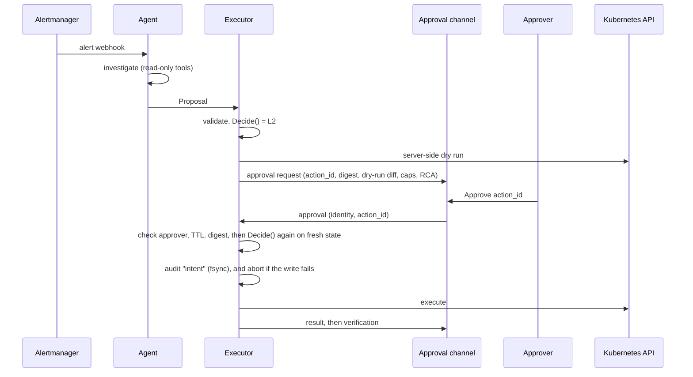

# ADR 0001: Autonomy and trust model

- **Status:** Superseded by [ADR 0003: Trust model and safety invariants](0003-trust-model-and-safety-invariants.md). Kept as history; its safety invariants are restated there.
- **Date:** 2026-10-13
- **Deciders:** @itsankoff
- **Roadmap:** M4.1. Must be accepted before M4.2 (runbook registry and executor) starts.
- **Related:** [README: Trust model](../../README.md#trust-model), [roadmap](../roadmap.md) M2.1 (audit log), M2.3 (MCP tools), M2.4 (RCA schema), M4, M5

## Context

incident-copilot uses an LLM to decide what is broken and what to do about it. Investigation is read-only: a bad diagnosis wastes an engineer's time, but changes nothing. Remediation changes the state of the cluster, and a wrong or manipulated choice can turn a partial outage into a full one. This ADR decides how much the agent may do on its own, who checks it, and how that is enforced.

The forces:

1. **The model is not a trustworthy decision maker.** Its output is non-deterministic. Its self-reported confidence is not calibrated. It can be wrong with full confidence, for example by blaming the most recent deploy for a memory leak (the decoy scenario in M5.4).
2. **The model reads input that attackers can influence.** Log lines, Kubernetes event messages, annotations, commit messages, and alert annotations all reach the context window. Anyone who can make a service log a string can try prompt injection. An instruction in the system prompt is not a control.
3. **Speed is the point.** The agent is valuable because it shortens the first minutes of an incident. Requiring a human for every action is safe, but gives up that value for low-risk, well-understood actions such as restarting a leaking pod at 3 a.m.
4. **Every action must be reconstructable.** Post-incident reviews need it, and so do regulated operators (an insurer's ICT incident-management obligations under DORA, for example).
5. **Trust is earned gradually.** A team adopting the agent starts in observe-only mode and widens autonomy one action at a time as evidence builds up.
6. **Small enough to verify.** The project is plain Go with no agent framework. The safety mechanism must be small enough to read in one sitting and to test exhaustively.

**Prior art.** Azure SRE Agent offers agent-wide run modes: *ReadOnly*, *Review* (the agent proposes and a human approves), and *Autonomous*. Its write power is whatever the Azure RBAC roles on its managed identity allow, and it executes CLI commands within those roles. This ADR keeps the same ladder, but sets it per runbook and per environment, and replaces "any command the role allows" with a closed set of typed actions.

## Decision

**The model proposes, and deterministic code decides.** The model is treated as an untrusted advisor whose output is data, never a command. The system is designed so that a model that is wrong, or fully hijacked by injected text, can at worst:

> propose **one allowlisted runbook**, with **in-bounds parameters**, against a **target tied to the incident**, at **no higher a level than humans configured**, **rate-limited** and **audited**.

Everything below exists to make that sentence true.

### D1. A closed action space

The agent can choose only from runbooks registered in code (`internal/runbook`). It never runs shell commands, `kubectl exec`, free-form patches, or deletes of controllers. "No action, escalate to a human" is always a valid proposal.

Each runbook declares a typed parameter schema, the target kinds it accepts, its maximum level, its preconditions, its bounds, and its cooldown. The model's proposal is part of the RCA and is validated by M2.4. An unknown runbook, an unknown or extra field, or an out-of-range parameter rejects the proposal. The RCA is still posted, with no proposed action, and the rejection is audited.

Runbooks in v1:

| Runbook | Effect | Bounds | Preconditions (checked in code) | Max level | Cooldown |
|---|---|---|---|---|---|
| `rollback_deployment` | Roll a Deployment back to its previous ReplicaSet revision | Exactly one revision back | A previous revision exists, and the current revision was rolled out no more than 60 min before the alert started | **L2** | Once per target per incident |
| `restart_pod` | Evict one pod through the Eviction API, which honours PodDisruptionBudgets | One pod per action | The pod is owned by a Deployment's ReplicaSet, and at least one other replica is Ready | **L3** | Once per Deployment per 30 min |
| `scale_up` | Raise a Deployment's replica count | +1 replica per action, and never above the policy cap (default: 2× the replica count when the incident opened) | No HorizontalPodAutoscaler targets the Deployment | **L3** | Once per target per 30 min |

`rollback_deployment` is capped at L2 because a rollback reverts the whole release, including changes unrelated to the incident, and can collide with forward-only changes such as schema migrations that the agent cannot see.

Adding a runbook, or raising a runbook's maximum level, is a code change that goes through review and comes with tests. New runbooks start at max L1 (see D8).

### D2. Autonomy levels

| Level | Name | What happens to a proposed action | Who executes |
|---|---|---|---|
| **L0** | Observe | It is recorded in the audit log only. The ticket says "Proposed action: none (observe-only)". | Nobody |
| **L1** | Suggest | It is shown in the ticket, with its parameters and the reason it was not automated. | A human, by hand |
| **L2** | Approve | It waits for an explicit approval bound to that exact action (D5). | The executor, after approval |
| **L3** | Autonomous | It runs immediately and is reported in the ticket straight away (D6). | The executor |

L0 doubles as **shadow mode**: the agent runs on real incidents, its would-be actions are logged, and they can be scored without touching anything.

### D3. The effective level is computed in code, and can only go down

```
effective = min(
    runbook.max_level,                // in code, reviewed
    policy.environment_ceiling,       // config, per environment
    policy.override,                  // config, the kill switch, re-read on every decision
    confidence_cap(rca.confidence),   // high → L3, medium → L2, low → L1
    guard_cap,                        // L1 if any scope, precondition, cooldown, or rate-limit check fails
)
```

Properties:

- **Downgrade only.** Every input can lower the level, and none can raise it above what a human configured. The model influences exactly one input, its confidence, and that input can only lower the level. A model that claims `high` confidence gets L3 only where humans have already allowed L3.
- **Pure and exhaustively tested.** `policy.Decide` is a pure function of the proposal, the runbook, the policy, a snapshot of cluster state, and the action history. It has no I/O and no clock reads of its own, so it is table-tested over the full set of input combinations.
- **Every cap is explained.** The decision lists each input that lowered the level and why ("capped at L1: target `inventory` is not the alerting workload `orders`"). That list goes into the ticket and the audit log.
- **Computed twice, trusted once.** The agent computes it to write the ticket. The executor recomputes it from fresh cluster state at execution time, and only the executor's result counts.
- **Fail closed.** An unknown environment is treated as `production`. A missing or unparseable policy means ceiling L1. A precondition that errors counts as failed.

Default ceilings per environment:

| Runbook | Max level | `staging` | `production` |
|---|---|---|---|
| `rollback_deployment` | L2 | L2 | L2 |
| `restart_pod` | L3 | L3 | L2 |
| `scale_up` | L3 | L3 | L2 |

The environment comes from configuration (`ENVIRONMENT`), not from anything the model says. Each environment runs its own incident-copilot deployment.

**Scope binding.** A proposal's target must be in an allowlisted namespace (policy `namespaces`) **and** must be the workload named by the triggering alert's labels (`namespace` plus `service` or `pod`). An action against any other workload is capped at L1. Text injected into logs ("roll back payments-api") therefore cannot point an automated action at a service outside the incident. The same rule turns the M5.4 decoy, a harmless `inventory` deploy just before an `orders` memory leak, into a suggestion rather than an automatic rollback of the wrong service.

### D4. The agent and the executor are separated

One binary runs in two roles, the same pattern as `demo-svc`: `--role=agent` and `--role=executor`. Each role has its own Deployment and its own ServiceAccount in the `incident-copilot` namespace.

| | Agent | Executor |
|---|---|---|
| Purpose | Investigate, write the RCA, propose an action | Decide, gate, execute, verify |
| Calls an LLM | Yes | **Never.** No model output reaches it except a schema-validated proposal. |
| Kubernetes RBAC | `get`, `list`, `watch` only, including events and ReplicaSets | A Role per allowlisted namespace: `patch` on `deployments`, `patch` on `deployments/scale`, `create` on `pods/eviction`, `get` and `list` on the objects that preconditions read, and `get` on the policy ConfigMap (restricted with `resourceNames`) |
| Credentials | LLM provider, read-only tool backends, ticketing | Approval channels (Slack, ticketing read) |
| Reachable by | Alertmanager | The agent only (NetworkPolicy) |

The executor's internal API accepts only a `Proposal`, and the executor validates it again against the registry and schemas. It does not trust the agent's decision, scope check, or claim of approval.

Sketch of the core types (illustrative, not final):

```go
type Level int // L0 to L3

type Proposal struct {
    IncidentID string
    Runbook    string          // must exist in the registry
    Target     Target          // kind, namespace, name
    Params     json.RawMessage // validated against the runbook's schema
    Confidence Confidence      // from the RCA, can only lower the level
}

type Decision struct {
    Level  Level
    Caps   []Cap  // every input that lowered the level, with its reason
    Digest string // hash of runbook, target, params, target generation, and the dry-run result
}

func Decide(p Proposal, rb Runbook, pol Policy, st Snapshot, h History) Decision
```

### D5. The approval gate (L2): approve exactly what you see



- **The approval request shows what will happen**, not what the model meant: the runbook, the target, the parameters, the **server-side dry-run** diff (`dryRun=All`), the RCA summary and confidence, and the caps that put the action at L2.
- **The approval is bound to a digest** of the runbook, target, parameters, the target's `metadata.generation`, and the dry-run result. A different proposal, or a target whose spec changed since the request (someone already rolled back by hand, say), invalidates the approval. The executor then aborts and updates the ticket rather than act on a stale picture. `generation` is used rather than `resourceVersion` because it changes only when the spec changes, not on every status update.
- **Silence is not consent.** An approval request expires after 15 minutes by default, and expiry counts as a denial.
- **One authorised approver is enough**, in every environment including `production`. A second approver may be required later, through a new ADR.
- **Only authorised approvers count.** The approver set comes from the policy (Slack user IDs or a user group, a ServiceNow assignment group, GitHub logins for the Issues fallback, and the identities allowed to sign in on an approval link). The approver's identity is the one the channel asserts and the executor verifies:
  - Slack requests are checked against the signing secret.
  - ServiceNow and GitHub state is read through their APIs with the executor's own credentials.
  - An **approval link** is single-use, expires with the request, and is bound to the `action_id` and digest. Opening it is not an approval: the approver must sign in on the page the link opens, and the executor records the authenticated identity. Holding the link proves nothing, because emails and notifications get forwarded.
- **The executor owns the gate.** The agent cannot mark anything as approved.
- **A denial is final** for that runbook and target within the incident. The agent cannot re-propose it until the incident is resolved.
- **Channels sit behind the existing `Approver` interface:** a ServiceNow state change, a Slack button, a `/approve <action_id>` comment on the GitHub issue, or an approval link. **Email** and **push notifications** only deliver an approval link. They carry no approval of their own.
- **Any configured channel is accepted for now.** Restricting which channels may approve, per environment or per runbook, is deferred to a later change.

### D6. Guardrails for L3

- **No autonomous chains.** At most one L3 action per incident. If the alert has not resolved within the verification window (10 minutes by default), every later proposal in that incident is capped at L2.
- **Cooldowns and rate limits.** Each runbook has a cooldown per target (D1), and there is a global limit (default: 3 L3 actions per hour). A breach caps the level at L2. This stops the agent from hiding a memory leak behind a restart every few minutes: the second restart needs a human.
- **One action per target at a time.** The executor holds a lock per target.
- **Verify, and never retry blindly.** After acting, the executor checks the mechanical result (rollout complete, pod Ready), and the agent checks whether the alert resolved (Alertmanager sends `resolved`). A failed state-changing action is never retried automatically. It escalates.
- **Report immediately.** An L3 action appears in the ticket as soon as it runs, with the same detail an approver would have seen.

### D7. The audit log: written before the action, and fail closed

- **What is recorded:** the alert, every tool call with its arguments and redacted result, every LLM request and response, the proposal, the decision with each cap, the dry run, the approval request, the approval, denial, or expiry with the approver's identity, the intent to execute, the result, and the verification.
- **Write-ahead.** The executor writes and fsyncs an `intent` entry before it calls the Kubernetes API, and a `result` entry afterwards. **If the intent write fails, the action does not run.**
- **Format.** Hash-chained JSONL (M2.1). Each role writes its own chain, and entries carry `incident_id` and `action_id` so the chains can be joined. This makes the log tamper-evident, not tamper-proof. In production the log would be shipped to immutable storage (an Azure Blob immutability policy, for example), which is out of scope for v1.
- **Redaction** of secrets happens before data reaches either the LLM or the audit log.
- **Separate streams.** The audit log is not the operational log, and nothing reads it in order to make decisions, apart from the cooldown and rate-limit history.

### D8. Autonomy is earned with evidence

- A new runbook starts at max L1.
- Raising a runbook's max level, or raising an environment ceiling, needs evidence from the eval harness. The initial thresholds: runbook accuracy of at least 95% over at least 20 runs across all scenarios, including the decoy, with **zero unsafe actions**. The change also needs review: a code PR for a max level, a config PR for a ceiling.
- Lowering a level is always allowed, takes effect immediately, and needs no review. The kill switch (`policy.override`, for example `L1` or `L0`) is re-read on every decision, with no restart.
- The eval harness gains an **unsafe action rate** metric: the share of runs in which an action would have executed at L2 or L3 while the ground truth says that runbook is wrong. This goes into M5.1 and M5.2.

## Safety invariants

This list is the canonical one. Relaxing any invariant needs a new ADR that supersedes this one.

1. **Allowlist only.** The agent chooses only from registered runbooks, with typed and bounded parameters. No arbitrary commands.
2. **Levels are enforced in code.** The effective level is the minimum of its inputs, and nothing the model produces can raise it.
3. **Read and write are separated.** Investigation tools are read-only. Only the executor holds write credentials, and the executor never calls an LLM.
4. **Actions are bound to scope.** Automated actions target only the alerting workload in an allowlisted namespace.
5. **An approval is specific and expires.** It is bound to the action's digest, it is re-checked against fresh state, and silence is never consent.
6. **The audit entry comes first.** A failed audit write blocks the action.
7. **Secrets never reach the LLM or the audit log.**
8. **Fail closed.** Errors, missing configuration, and unknown environments lower the level, never raise it.
9. **No autonomous chains.** At most one L3 action per incident, and a failed verification escalates to a human.

## Consequences

**Positive**

- Even in the worst case the blast radius is bounded by construction, not by how well the model behaves, so prompt injection becomes a nuisance rather than an incident.
- Every decision can be explained ("L2 because production caps `restart_pod` at L2") and reconstructed from the audit log.
- Teams can adopt the agent step by step, from shadow mode (L0) to suggestions to approvals to autonomy, one runbook at a time.
- The safety core (`Decide`, the registry, the gate) is small, pure, and testable without a cluster.

**Negative**

- **Coverage is narrow.** Most real incidents will end in "escalate". This is accepted: a correct RCA delivered fast is most of the value.
- **L2 adds human latency.** Production restarts wait for a person. Mitigations: a clear approval request, a one-click Slack approval, and promotion to L3 once there is evidence.
- **Scope binding is conservative.** An action on a dependency, such as restarting `inventory` when the alert is on `orders`, is never automated.
- **More moving parts.** A second Deployment, an internal API, a NetworkPolicy, a policy ConfigMap, and new configuration (`ENVIRONMENT`, `SLACK_SIGNING_SECRET`, and settings for email, push delivery, and approval-link sign-in), which go into the README table when M4.2 and M4.3 add them.
- **Confidence is a weak signal.** It is used only as a brake, so a model that is wrong and confident still reaches the configured ceiling. The real protection is the ceiling plus the eval-based promotion.

**Residual risks (out of scope for v1)**

- A compromised agent process can submit forged proposals. They remain bounded by the allowlist, the ceilings, and approval, but the executor does not yet re-fetch the alert from Alertmanager to check scope on its own.
- A compromised approver account, or an insider with cluster-admin rights.
- Tamper-proof storage of the audit log.

## Alternatives considered

| Alternative | Why it was rejected |
|---|---|
| **Guardrails in the prompt only** ("never delete anything") | Not enforceable. The same context window that holds the rule also holds attacker-controlled log lines. |
| **Free-form commands bounded by RBAC** (the Azure SRE Agent model) | RBAC limits *which* resources, not *which actions make sense*. The action space is unbounded, so neither a reviewer nor the eval harness can reason about it. |
| **A policy engine over arbitrary commands, or admission control** (OPA Gatekeeper, Kyverno) | A good second layer, but it does not shrink the action space, and it is heavy for kind. Reconsider for AKS (M6), where Azure Policy for AKS provides Gatekeeper. |
| **Humans execute everything** (L1 everywhere) | Safe, but gives up the speed that justifies the agent. It remains available as a ceiling or through the kill switch. |
| **Autonomy driven by confidence** (high confidence unlocks action) | Self-reported confidence is not calibrated and is produced by the very model being guarded. Used only to lower the level. |
| **One process with read and write credentials** | Simpler, but then any compromise of the model loop holds write credentials. The split costs one more Deployment. |
| **One agent-wide mode instead of per-runbook levels** | Too coarse. A restart and a rollback carry very different risks, and teams need to promote them separately. |

## Validation

ADR-specific checks are marked ★. The rest are already in the roadmap.

| Check | Where |
|---|---|
| Table test of `Decide` over every combination of max level, ceiling, override, confidence, and guard result; the result is never above any single input ★ | M4.2 |
| A proposal with an unknown runbook, an extra field, or an out-of-range parameter is rejected | M2.4, M4.2 |
| A fake LLM that asks for a higher level is refused | M4.2 |
| A fake LLM that targets a workload outside the alert is capped at L1 ★ | M4.2 |
| A failing audit writer blocks execution | M4.2 |
| The agent's ServiceAccount cannot `patch`, `create`, or `delete` (RBAC test) ★ | M4.2 |
| Approve, deny, and timeout, with the approver's identity audited | M4.3 |
| An approval for digest A does not execute digest B. A target whose `generation` changed after approval aborts ★ | M4.3 |
| A second L3 action in the same incident, or one inside a cooldown, is capped at L2 ★ | M4.2 |
| Setting the kill switch to L1 stops autonomous execution on the next decision, with no restart ★ | M4.4 |
| memory-leak restarts at L3 in staging, bad-config waits for approval at L2, and dependency-timeout proposes no action | M4.4 |
| Each incident can be fully reconstructed from the audit log | M4.4 |
| The unsafe action rate is reported, and is zero on the decoy scenario before any promotion ★ | M5.1, M5.4 |

## Follow-ups

- The **Safety invariants** section above is the canonical list. The roadmap's rule on relaxing an invariant points here. CLAUDE.md is intentionally left as is. Component boundaries and the RCA contract are in [`arch-diagram.md`](arch-diagram.md), and engineering conventions are in [`CONTRIBUTING.md`](../../CONTRIBUTING.md).
- The unsafe action rate is part of the M5.1 report and the M5.2 scoring in the roadmap, and so are the ★ checks above.
- Restricting the allowed approval channels per environment or runbook is deferred (D5).
- Whether the Slack channel uses Socket Mode, so the kind setup needs no public endpoint, is an M4.3 implementation choice, not an ADR decision.
