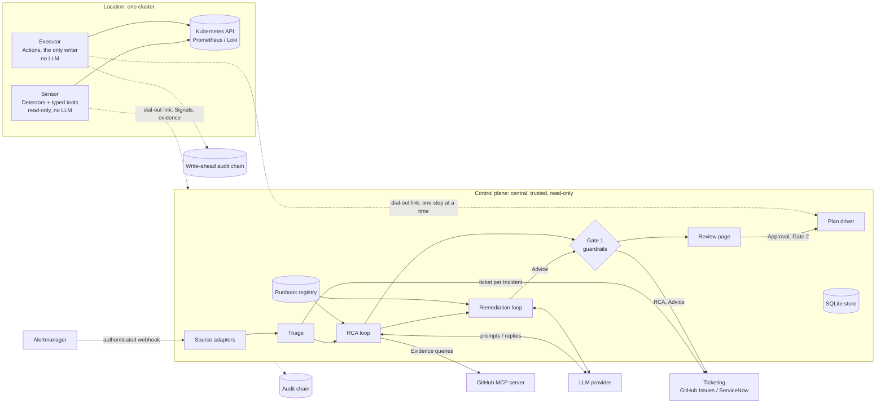

# Architecture diagram

## Architecture

Flow: **Signal → Triage → Incident → RCA → Advice → Approval → Plan → Execute → Verify**, with every step recorded.

All three roles are one Go binary. The Control plane is central and serves one or more Environments. Each watched Location gets a Sensor and an Executor, which dial out to the Control plane; nothing connects into a Location. The quick start runs all three in one cluster. See [ADR 0002](0002-product-scope-and-platform-seams.md) D2.

## Components and their boundaries

- **Control plane.** Takes in Signals, runs Triage, runs both LLM loops, checks every LLM output (Gate 1), serves the Plan review page and collects Approvals (Gate 2), writes tickets, and drives each Plan one step at a time. It is trusted, holds only read-only credentials, and never changes state itself. It keeps its state in SQLite on one replica, plus its own audit chain.
- **Source adapters.** One per kind of Signal source. Each authenticates the sender (mandatory), splits batches, and maps each alert to a Signal. Only Alertmanager in v1. See [ADR 0002](0002-product-scope-and-platform-seams.md) D3.
- **Triage.** Deterministic, table-tested code, never an LLM. Joins Signals into at most one open Incident per Target and decides when to investigate. See [ADR 0002](0002-product-scope-and-platform-seams.md) D4.
- **RCA loop and remediation loop.** Plain Go with direct LLM tool calling and **no agent framework**. The loop owns tool dispatch, retries, and budgets (steps, tokens, wall-clock time), and must still produce an RCA, with `low` confidence if needed, when a budget runs out. The RCA loop diagnoses with read-only Evidence queries; the remediation loop writes Advice composed only of Actions that Executors offer. See [ADR 0002](0002-product-scope-and-platform-seams.md) D7 and D8.
- **LLM provider.** A small interface. Nothing outside the provider package may import vendor SDK types.
- **Runbook registry.** Approved, versioned Runbooks in the Control plane's store, matched by Signal and Target. Their guidance feeds the RCA loop and their actions feed the remediation loop. They never run.
- **Evidence sources.** Each backend is reached through exactly one route: Sensor typed tools in the Location, or an MCP server reached through our own MCP client next to the Control plane (GitHub in v1). Every result is redacted, size-capped, and wrapped in an evidence ref. The Sensor relay to MCP servers inside a Location is designed but built after v1.
- **Sensor.** One per Location, read-only, never calls an LLM. Runs the five Kubernetes Detectors and answers Evidence queries within its namespace allowlist, redacting at the source. See [ADR 0002](0002-product-scope-and-platform-seams.md) D5.
- **Executor.** One per Location, the only component that changes state, and it never calls an LLM. It runs one Action per call with its Location's own credentials: validate, write the audit intent, check the Target version and preconditions, apply, run the Action's mechanical check, report. It has no access to ticketing or approval channels.
- **Ticketing adapter.** An interface with GitHub Issues and ServiceNow implementations. One ticket per Incident, and the ticket is the source of truth for human-facing state.
- **Audit log.** Hash-chained JSONL, one chain in the Control plane and a write-ahead chain in each Executor. Records every Signal, tool call, LLM request and response, Gate 1 result, decision, Approval, and step. See [ADR 0003](0003-trust-model-and-safety-invariants.md) D8.

### The platform seam

Anything that decides is core; anything that talks to a platform API is per-platform. The core calls platforms only through the Sensor's Detectors and evidence tools and the Executor's Actions, and never imports a platform package. Kubernetes is the only implementation. See [ADR 0002](0002-product-scope-and-platform-seams.md) D6.

The safety invariants these boundaries enforce are listed in [ADR 0003](0003-trust-model-and-safety-invariants.md#safety-invariants).

## RCA contract

The RCA is a typed Go struct, and the LLM's output is validated against it. Free text is never passed through. Fields: `summary`, `started_at`, `introduced_by`, `impact`, `confidence` (`low|medium|high`), `evidence_ledger`, and `gaps`. Each field is made of Claims that cite evidence refs or other Claims, and Gate 1 checks every citation. The RCA holds the diagnosis only; the remediation is Advice, a separate output. See [ADR 0002](0002-product-scope-and-platform-seams.md) D7.
