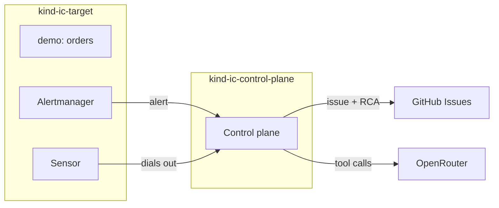

# Demo: from a failing rollout to a cited RCA

This guide runs incident-copilot on your machine and shows it investigating a real Kubernetes failure. You break a deployment, an alert fires, and incident-copilot opens a GitHub issue, investigates the cluster, and writes a root-cause analysis (RCA) into the issue. Every Claim in the RCA cites the queries behind it.

It takes about 20 minutes, most of it waiting for clusters to start.

## What runs where

Two local [kind](https://kind.sigs.k8s.io) clusters stand in for production:

- **`ic-target`** runs a small demo app (`orders`, `inventory`, `loadgen`) with Prometheus, Alertmanager, and Loki. It also runs the **Sensor**, which reads cluster state for investigations and dials out to the Control plane.
- **`ic-control-plane`** runs the incident-copilot **Control plane**. It receives alerts, opens Incidents and tickets, and runs the investigation with an LLM.



## Before you start

**Tools.** Go 1.25+, Docker, kind, `kubectl`, Helm, and the `gh` CLI (on macOS: `brew install go kind kubectl helm gh`). Give Docker at least **6 CPUs and 10 GB of memory**, because the demo runs two clusters.

**A GitHub repository for tickets.** Create a **private** repository just for demo incidents, for example `<you>/incident-copilot-demo-tickets`, with Issues enabled. Keep it private, because RCAs quote cluster state.

**A fine-grained GitHub token** for that repository only: GitHub → Settings → Developer settings → Fine-grained tokens. Give it **Issues: Read and write** and nothing else.

**An OpenRouter API key** from [openrouter.ai](https://openrouter.ai). The demo uses the free model tier, `openrouter/free`, so it costs nothing. The free tier picks a model for each request, and the RCA records which model answered.

**The env file.** Copy the example and fill it in. `.env.demo` is gitignored.

```sh
cp .env.demo.example .env.demo
```

```sh
IC_GITHUB_REPO=<you>/incident-copilot-demo-tickets
IC_GITHUB_TOKEN=github_pat_...
OPENROUTER_API_KEY=sk-or-...
IC_LLM_MODEL=openrouter/free
```

Run every command below from the repository root.

## 1. Start the clusters

```sh
make tools                                   # check the prerequisites
make down                                    # start clean; fine if no clusters exist
make cluster deploy control-plane sensor     # about 10 minutes the first time
make status                                  # every pod Running and Ready
```

Start from clean clusters. The Control plane's state survives redeploys, and alerts on old clusters join old Incidents instead of opening new ones.

## 2. Watch the Control plane

In a second terminal:

```sh
kubectl --context kind-ic-control-plane -n incident-copilot logs -f deploy/control-plane
```

To watch alerts too, run `make port-forward` in a third terminal and open Alertmanager at http://localhost:9093.

## 3. Break the rollout

```sh
make fault          # lists the scenarios and what each should produce
make fault F=crash-loop
```

This rolls out `orders` with a malformed config value. The new pod exits at startup, and the old pods keep serving.

## 4. What to expect

| About | What happens |
|---|---|
| 0:00 | The new `orders` pod starts crash-looping. The old pods keep serving. |
| 2:30 | `DeploymentRolloutStuck` fires, then `PodCrashLooping` at about 3:00. Both name `namespace=demo` and `deployment=orders`. |
| right after | The Control plane opens an Incident, and a new issue appears in your tickets repository. |
| within 5 min | A **Root-cause analysis** comment appears on that issue. |

```sh
gh issue list -R <you>/incident-copilot-demo-tickets
gh issue view <n> -R <you>/incident-copilot-demo-tickets --comments
```

## 5. Read the RCA

- **Observed Claims** state facts from the cluster and cite the `workload_state` and `events` calls they came from. Expect them to point at the new ReplicaSet, its bad config, and `CrashLoopBackOff`.
- **Inferred Claims** draw conclusions and cite other Claims.
- **Every citation is checked** against this Incident's audit log before the RCA is written. A Claim whose citation doesn't check out is marked, and confidence is capped at `low`.
- **The footer** names the configured model (`openrouter/free`) and the model that answered.
- Both alerts join **one Incident**, so you get one issue, not two.

## 6. Look at the audit log

Every alert, tool call, and LLM request and response is written to a hash-chained audit log in the Control plane. The image is distroless, with no shell, so read it from a debug container:

```sh
kubectl --context kind-ic-control-plane -n incident-copilot debug -it deploy/control-plane \
  --image=busybox:1.36 --target=control-plane --profile=general -- \
  sh -c 'grep -E "\"(llm\.|evidence\.query|gate1\.rca)" /proc/1/root/var/lib/incident-copilot/audit.jsonl | head -50'
```

You'll find the `llm.*` requests and responses with both model names, the `evidence.query` entries the Claims cite, and the `gate1.rca` citation check.

## 7. Try another fault, or clean up

```sh
make clear                      # restore the baseline; waits until pods are Ready and no alerts fire
make fault F=bad-image          # or unschedulable, oom
make down                       # delete both clusters when you're done
```

Run `make clear` between scenarios, and wait for the previous Incident's ticket to settle.

## Troubleshooting

- **No issue opens.** Check that Alertmanager shows a firing alert for `demo/orders`, then look for webhook or authentication errors in the Control plane logs. Check `IC_GITHUB_REPO` and the token's permissions.
- **The comment says "No RCA".** The investigation ran out of steps, tokens, or time before the model answered. On the free tier, this is usually a rate limit (`429`) or a slow model, and there's no retry yet. The Control plane logs say which. Run `make clear` and inject again.
- **No comment at all.** Without `OPENROUTER_API_KEY`, the Control plane opens tickets but doesn't investigate. It logs a warning at startup.
- **An Incident with no Target.** An alert fired without a `deployment` label. Please open an issue with the alert's name.

## Known limits

This demo is an early slice of incident-copilot:

- Investigations use two tools, `workload_state` and `events`. Metrics, logs, and change history come later.
- Claim text is not redacted yet.
- incident-copilot proposes no remediation yet.

The [roadmap](../README.md#roadmap) has what's next.
