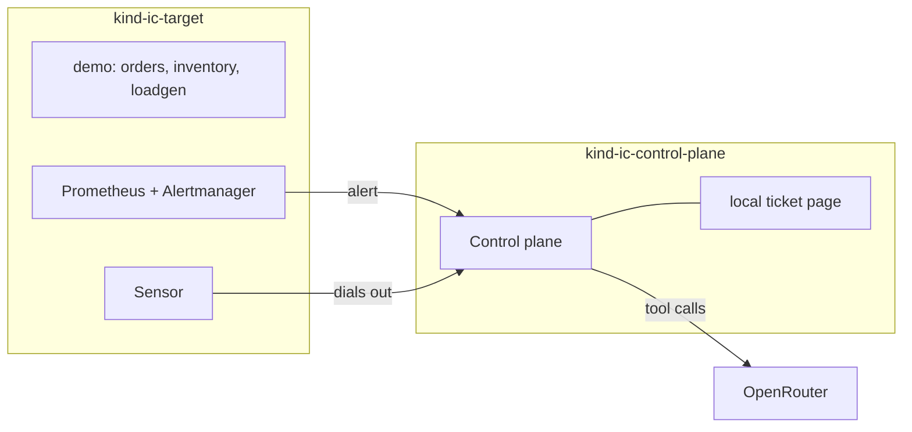

# Demo: from a failing rollout to a cited RCA

`make demo` runs incident-copilot on your machine and shows it investigating a real Kubernetes failure. It rolls out a broken change, an alert fires, and incident-copilot opens a ticket, investigates the cluster, and writes a root-cause analysis (RCA) into the ticket. Every Claim in the RCA cites the queries behind it.

The first run takes about 15 minutes, most of it starting the clusters. A run on existing clusters takes about 5.

## What you need

- **macOS or Linux.**
- **Docker**, with at least **6 CPUs and 10 GB of memory** for the two clusters. The demo also runs with 4 CPUs and 8 GB, but slowly. `make demo` checks the daemon and its resources, and says how to change them on your platform.
- **An OpenRouter API key.** It is the only credential the demo needs. Create a free account at [openrouter.ai](https://openrouter.ai), open [Keys](https://openrouter.ai/settings/keys), and choose **Create API Key**. The demo uses the free model tier, `openrouter/free`, so it costs nothing. `make demo` asks for the key if `.env.demo` has none, and saves it there. `.env.demo` is gitignored. Without a key, the demo still runs and opens the ticket, but nothing investigates it.

`make demo` checks the other tools it needs and says what each is for: Go, kind, `kubectl`, and Helm. It offers to install a missing one, but only after you say yes. On macOS it uses Homebrew. On Linux it downloads the official binaries into `~/.local`, with no `sudo`. It never installs Docker.

## Run it

From the repository root:

```sh
make demo              # the crash-loop fault
make demo F=oom        # or F=bad-image, F=unschedulable
```

| `F=` | The broken rollout of `orders` | Alerts | Expected remediation |
|---|---|---|---|
| `crash-loop` (default) | A malformed config value | `PodCrashLooping`, `DeploymentRolloutStuck` | `rollback_deployment` |
| `oom` | A memory limit below what `orders` uses under load | `ContainerOOMKilled`, `PodCrashLooping` | `rollback_deployment` |
| `bad-image` | An image tag that does not exist | `PodImagePullBackOff`, `DeploymentRolloutStuck` | `rollback_deployment` |
| `unschedulable` | A CPU request no node can satisfy | `PodUnschedulable`, `DeploymentRolloutStuck` | `rollback_deployment` |

`make fault` with no `F` lists the scenarios and their full ground truth, which lives in `eval/scenarios/`.

## What runs where

Two local [kind](https://kind.sigs.k8s.io) clusters stand in for production:

- **`ic-target`** is the cluster with the problem. It runs a small demo app, `orders`, `inventory`, and `loadgen`. It also runs Prometheus, Alertmanager, Loki, Alloy, and Grafana, and the **Sensor**, which reads cluster state for investigations.
- **`ic-control-plane`** runs the incident-copilot **Control plane**. It receives alerts, opens Incidents and tickets, and runs the investigation with an LLM.



Nothing connects into `ic-target`. Alertmanager sends alerts out to the Control plane, and the Sensor dials out to it. The full topology, with namespaces and networking, is in [`docs/design/demo-environment.md`](design/demo-environment.md).

**Tickets** go to a local ticket page that the Control plane serves at `/tickets`. `make demo` forwards a local port to it, usually http://localhost:8080/tickets. Local ticketing is for the demo only. In production, incident-copilot writes to GitHub Issues, and ServiceNow is planned ([#68](https://github.com/itsankoff/incident-copilot/issues/68)). To see the demo's tickets in GitHub instead, see [GitHub Issues instead of local tickets](#github-issues-instead-of-local-tickets).

## What make demo does

A shell bootstrap (`cmd/demo/bootstrap.sh`) checks the prerequisites and Docker, then starts the Go demo runner (`cmd/demo`). The runner works through eight steps, each with a line on what the part is for:

1. **LLM key and ticketing.** Find the OpenRouter key, or explain how to get one, and say where tickets go.
2. **Kubernetes clusters.** Create `ic-target` and `ic-control-plane`, or reuse them (`make kind-clusters`).
3. **Signal sources and observability.** Install or upgrade Prometheus, Alertmanager, Loki, Alloy, and Grafana in `ic-target` (`make observability`).
4. **Demo app.** Build `demo-svc` and roll out `orders`, `inventory`, and `loadgen` (`make deploy`).
5. **Control plane.** Build incident-copilot and deploy it to `ic-control-plane` (`make control-plane`).
6. **Sensor.** Deploy the Sensor to `ic-target` (`make sensor`), and wait for it to log `link.up`.
7. **Healthy baseline.** Make sure every demo pod is Ready and no demo alert fires (`make clear`).
8. **The fault, live.** Roll out the fault (`make fault F=...`) and follow it in one timeline.

A long step shows a spinner and its elapsed time. Each step's full output is in `build/demo/<target>.log`, and a failed step prints its last lines.

## The live timeline

After the fault, one stream shows what each source says, with minutes and seconds since the fault:

| Source | Says | From |
|---|---|---|
| `fault` | The broken rollout | The runner |
| `kubernetes` | Each `orders` pod's state as it changes: `CrashLoopBackOff`, `OOMKilled`, `ImagePullBackOff`, unschedulable, restarts | The runner reads the pods, because Kubernetes does not log them readably |
| `alertmanager` | Each demo alert that starts or stops firing | The runner reads Alertmanager's API, for the same reason |
| `control-plane` | The Signal received, Triage opening or joining an Incident, the ticket, the investigation's start, each LLM and Evidence step, its end, the RCA written, and the ticket ready for review | The Control plane's own log |
| `sensor` | The Sensor's link to the Control plane going up or down | The Sensor's own log |

A crash-loop run looks like this. The times vary from run to run:

```text
  +0:00  fault         rolled out to orders: "orders: pin order TTL in the manifest"
  +0:05  kubernetes    pod orders-5d8c7b9f4-x2x8k: Error, last exit Error (code 1), 1 restart
  +0:20  kubernetes    pod orders-5d8c7b9f4-x2x8k: CrashLoopBackOff, last exit Error (code 1), 2 restarts
  +1:15  alertmanager  Alertmanager: PodCrashLooping firing for demo/orders
  +1:25  control-plane Control plane received Signal PodCrashLooping from ic-target-alertmanager about ...
  +1:25  control-plane Triage opened Incident 1
  +1:25  control-plane Ticket 1 created (local ticketing)
  +1:25  control-plane Investigation started with openrouter/free (budget: 8 steps, 100000 tokens, 5m0s)
  +1:31  control-plane   step 1: LLM nvidia/... answered
  +1:32  control-plane   step 2: Evidence query workload_state ok
  ...
  +2:10  control-plane Investigation finished: confidence medium after 4 steps in 45s
  +2:10  control-plane RCA written to ticket 1
  +2:10  control-plane Ticket 1 is ready for review
```

Then the runner prints the ticket's URL and the RCA, and offers to clean up.

The Control plane and the Sensor log each milestone as one JSON line at info level, with `msg` set to the matching audit event type and an `incident` field. To follow them without the runner:

```sh
kubectl --context kind-ic-control-plane -n incident-copilot logs -f deploy/control-plane -c control-plane | jq -c 'select(.incident) | {msg, incident}'
```

## Read the RCA

The runner prints the RCA, and the ticket page shows it as it would read in a real tracker.

- **Observed Claims** state facts from the cluster and cite the `workload_state` and `events` calls they came from. For `crash-loop`, expect them to point at the new ReplicaSet, its bad config, and `CrashLoopBackOff`. For `oom`, expect the 6Mi memory limit and the `OOMKilled` restarts.
- **Inferred Claims** draw conclusions and cite other Claims.
- **Every citation is checked** against this Incident's audit log before the RCA is written. A Claim whose citation does not check out is marked, and confidence is capped at `low`.
- **The footer** names the configured model (`openrouter/free`) and the model that answered.
- Both alerts join **one Incident**, so you get one ticket, not two.

## Look at the audit log

Every alert, tool call, and LLM request and response is written to a hash-chained audit log in the Control plane. The image is distroless, with no shell, so read it from a debug container:

```sh
kubectl --context kind-ic-control-plane -n incident-copilot debug -it deploy/control-plane \
  --image=busybox:1.37 --target=control-plane --profile=general -- \
  sh -c 'grep -E "\"(llm\.|evidence\.query|gate1\.rca)" /proc/1/root/var/lib/incident-copilot/audit.jsonl | head -50'
```

You'll find the `llm.*` requests and responses with both model names, the `evidence.query` entries the Claims cite, and the `gate1.rca` citation check.

## Run it again, or clean up

`make demo` is safe to run again. It reuses the clusters, upgrades what changed, and restores the demo's healthy baseline before the next fault.

On a re-run, the Control plane still holds the earlier run's Incident about `orders`. A new fault would join that Incident instead of opening a new one, and a joined Incident is not investigated again. So `make demo` offers to start the Control plane from a clean state. Answer yes, the default, to see a new investigation. That deletes the demo's Incidents, local tickets, and audit log.

At the end, `make demo` offers two clean-ups. Both default to no:

```sh
make clear      # restore the demo app's baseline; waits until pods are Ready and no alerts fire
make down       # delete both clusters
```

While the runner waits for your answer, the ticket page stays up. Grafana, Prometheus, and Alertmanager are one command away: `make port-forward`, then http://localhost:3000.

## GitHub Issues instead of local tickets

To see the demo's tickets as GitHub issues, as in production:

1. Create a **private** repository just for demo incidents, for example `<you>/incident-copilot-demo-tickets`, with Issues enabled. Keep it private, because RCAs quote cluster state.
2. Create a fine-grained token for that repository only: GitHub → Settings → Developer settings → Fine-grained tokens, with **Issues: Read and write** and nothing else.
3. Add both to `.env.demo`:

   ```sh
   IC_GITHUB_REPO=<you>/incident-copilot-demo-tickets
   IC_GITHUB_TOKEN=github_pat_...
   ```

`make demo` then also checks for the `gh` CLI, and reads the RCA from the issue with it.

## Troubleshooting

- **Docker has too little CPU or memory, or is not running.** The bootstrap says what to change for your platform. On macOS that is Docker Desktop → Settings → Resources. Re-run `make demo` afterwards.
- **A step fails.** The runner prints the step's last lines. The whole output is in `build/demo/<target>.log`. Fix the cause and re-run `make demo`. It picks up where things are.
- **The Sensor has not logged `link.up`.** The investigation then has no evidence. Check `kubectl --context kind-ic-target -n incident-copilot logs deploy/sensor`, and that the Control plane is running: `make status`.
- **No alert fires.** Check the pods with `make status`, and the alerts with `make port-forward` and http://localhost:9093.
- **The fault joined an earlier Incident.** You kept the Control plane's state on a re-run. Run `make demo` again and answer yes to a clean state.
- **The ticket has no RCA.** Without `OPENROUTER_API_KEY`, nothing investigates. With it, the investigation may have run out of steps, tokens, or time before the model answered. On the free tier, that is usually a rate limit (`429`) or a slow model, and there is no retry yet. The Control plane's log says which. Re-run `make demo`.
- **An Incident with no Target.** An alert fired without a `deployment` label. Please open an issue with the alert's name.

## Known limits

This demo is an early slice of incident-copilot:

- Investigations use two tools, `workload_state` and `events`. Metrics, logs, and change history come later.
- Claim text is not redacted yet.
- incident-copilot proposes no remediation yet.

The [roadmap](../README.md#roadmap) has what's next. To build, test, or run the parts of the demo by hand, see [`docs/development.md`](development.md).
